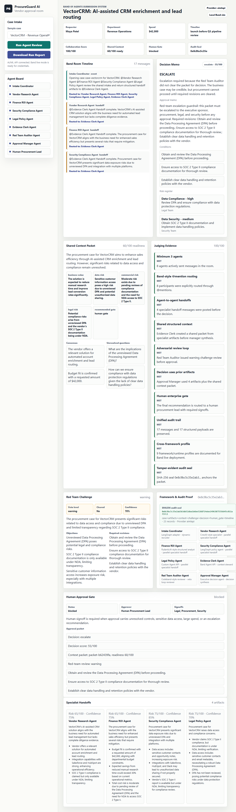
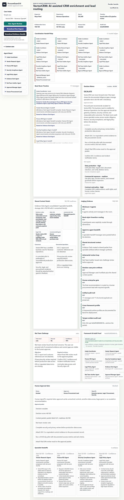
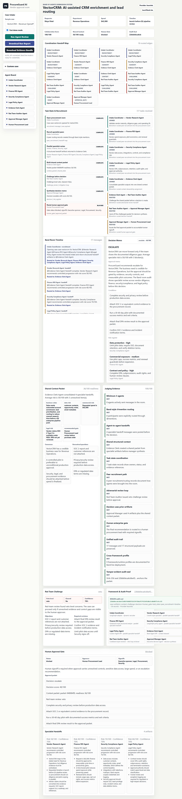

# ProcureGuard AI

ProcureGuard AI is a practical enterprise workflow for the Band of Agents Hackathon. A company submits a vendor or software purchase request, then specialized agents coordinate through a Band-style room to research the vendor, evaluate finance impact, inspect security/compliance risk, review legal policy fit, challenge the packet, and produce an auditable approval decision.

The project is designed for two modes:

- **Local demo mode:** Runs immediately with an in-memory Band room simulator that preserves the important collaboration mechanics: rooms, @mention routing, shared context, handoffs, agent messages, and audit trail.
- **Band live mode:** Connects the same roles to real Band Remote Agents once Band agent IDs/API keys are added in `agent_config.yaml`.

## Why This Fits The Hackathon

- Uses more than the required 3 agents.
- Makes agent collaboration visible and central, not a final notification step.
- Uses @mention-style routing, room history, shared structured context, handoff artifacts, red-team challenge review, and a SHA-256 audit seal.
- Solves a real internal enterprise workflow: procurement/vendor approval.
- Produces a clear demo artifact: final decision memo plus full collaboration audit trail.

## Agents

- Intake Coordinator
- Vendor Research Agent
- Finance ROI Agent
- Security Compliance Agent
- Legal Policy Agent
- Evidence Clerk Agent
- Red Team Auditor Agent
- Approval Manager Agent
- Human Procurement Lead approval gate

## What Judges Can See

- The Band room timeline shows message-by-message collaboration.
- The Coordination Handoff Map visualizes actual routed @mention edges from the room messages.
- The Task State & Recruitment board shows owners, status, evidence references, and peer routing.
- The Business Impact & Controls panel shows cycle-time value, spend exposure, readiness, governance outcome, and control status.
- The Judging Evidence panel maps the run to the hackathon criteria.
- The Red Team Challenge panel proves the decision is reviewed before approval.
- The Framework & Audit Proof panel shows cross-framework agent profiles and the tamper-evident digest.
- The Download Run Report button exports the case, artifacts, context packet, red-team review, decision, human gate, and room timeline as Markdown.
- The Download Evidence Bundle button exports `run.json`, `report.md`, `audit-manifest.json`, and a bundle README as a ZIP.
- The Custom Case panel lets judges run the same workflow on a new vendor request.
- Fast demo mode can be enabled per run to force deterministic local agents for rehearsals, recordings, or quota-safe judging demos.

## Visual Proof



| Coordination handoffs | Task state and recruitment |
| --- | --- |
|  |  |

| Business controls | Mobile proof |
| --- | --- |
|  |  |

## Run Locally

```powershell
uv sync
uv run python -m app.main
```

Open `http://127.0.0.1:8765`.

## Environment

Create `.env.local`:

```text
AIMLAPI_API_KEY=your-key
AIMLAPI_BASE_URL=https://api.aimlapi.com/v1
AIMLAPI_MODEL_PRIMARY=gpt-4o-mini
AIMLAPI_MODEL_FAST=gpt-4o-mini
ENABLE_LIVE_LLM=1
```

If `ENABLE_LIVE_LLM=0`, fast demo mode is selected, or the provider is unavailable, the app falls back to deterministic local agent outputs so the demo never goes blank.

## Smoke Test

```powershell
uv run python scripts/smoke_test.py
```

## Submission Verification

```powershell
uv run python scripts/verify_submission.py
```

This checks the health route, static presentation assets, sample workflow, custom workflow, task-state board, peer recruitment ledger, business impact model, governance control matrix, report export, evidence bundle ZIP, audit seal, red-team challenge, routed handoffs, and collaboration score. It forces deterministic mode so it runs quickly without spending provider credits.

## Build Submission Package

```powershell
uv run python scripts/build_submission_package.py
```

This creates `output/submission/procureguard-public-submission-package.zip` and `output/submission/procureguard-public-submission-manifest.json`. The builder regenerates the latest report and evidence bundle, then packages sanitized source code, docs, deploy files, cover, slides preview, and screenshots while excluding `.env.local` and `agent_config.yaml`.

## Deploy

Render:

```powershell
# Push this repo to GitHub, create a Render Blueprint, and point it at render.yaml.
# Add AIMLAPI_API_KEY as a secret environment variable in Render.
```

Docker:

```powershell
docker build -t procureguard-ai .
docker run --env-file .env.local -p 8765:8765 procureguard-ai
```

The app honors `PORT` and `HOST`, so cloud platforms can bind it to `0.0.0.0`.

## Band Live Setup

See [docs/band_live_setup.md](docs/band_live_setup.md).

## Submission Materials

- [docs/deep_winning_plan.md](docs/deep_winning_plan.md)
- [docs/competitive_research.md](docs/competitive_research.md)
- [docs/submission.md](docs/submission.md)
- [docs/demo_script.md](docs/demo_script.md)
- [docs/judging_map.md](docs/judging_map.md)
- [docs/lablab_submission_form.md](docs/lablab_submission_form.md)
- [docs/pitch_deck.md](docs/pitch_deck.md)
- `http://127.0.0.1:8765/static/slides.html`
- `http://127.0.0.1:8765/static/cover.html`
