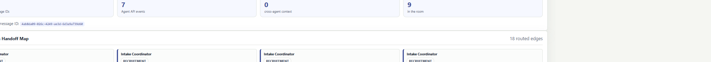
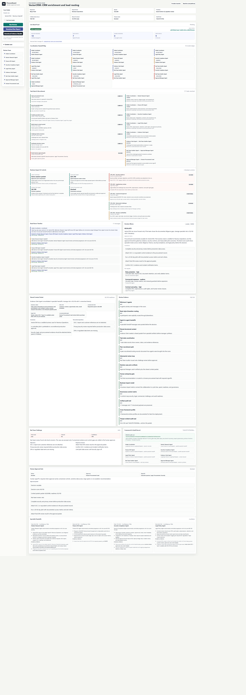
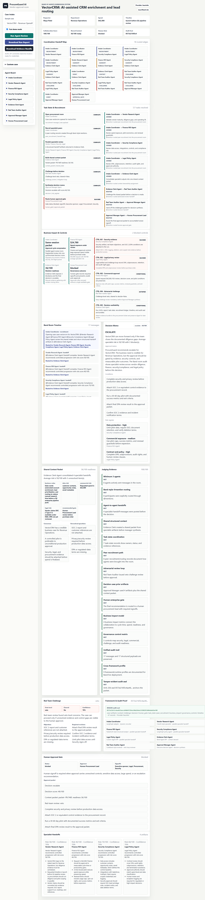
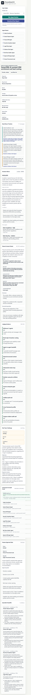

# ProcureGuard

ProcureGuard is a vendor approval workspace for teams that need procurement, finance, security, legal, and leadership review in one place.

Instead of sending a purchase request through separate email threads and spreadsheets, the system opens a shared review room. Specialist agents inspect the same request, hand off structured findings, challenge unsafe assumptions, and produce a decision packet that a human approver can audit before a purchase order moves forward.

## What The App Does

- Opens a vendor or software purchase case with requester, department, spend, timeline, data access, integrations, and diligence notes.
- Routes work between specialist roles using room messages and @mention-style handoffs.
- Builds a shared context packet from vendor, finance, security, and legal findings.
- Runs a red-team review before the approval decision is finalized.
- Produces a decision memo with conditions, blockers, risk register, signoffs, and human approval status.
- Exports a Markdown report and evidence bundle for attachment to a procurement ticket.
- Supports a fast local review mode, live provider-backed runs, and a Band Remote Agent setup path.

## Workflow

1. The Intake Coordinator opens the request and recruits the review roles.
2. Vendor Research, Finance ROI, Security Compliance, and Legal Policy review the case in parallel.
3. The Evidence Clerk consolidates their findings into one shared packet.
4. The Red Team Auditor challenges missing evidence or unsafe assumptions.
5. The Approval Manager writes the final recommendation.
6. The Human Procurement Lead receives the approval packet and required signoffs.

## Review Roles

- Intake Coordinator
- Vendor Research Agent
- Finance ROI Agent
- Security Compliance Agent
- Legal Policy Agent
- Evidence Clerk Agent
- Red Team Auditor Agent
- Approval Manager Agent
- Human Procurement Lead

## Live Band Proof

ProcureGuard runs on the real Band platform (`app.band.ai`), not a simulator. A recorded live run created a real Band room, delivered routed `@mention` messages and task events with Band-issued UUIDs, and the messages were read back through Band's own context API. See [docs/proof/](docs/proof/) for the captured room ID, message IDs, and run JSON.





## Screenshots And Video

- Live Band walkthrough video: `output/submission/procureguard-live-band-walkthrough.webm`
- Earlier simulator walkthrough: `output/submission/procureguard-demo.webm`

| Handoff map | Task state |
| --- | --- |
|  |  |

| Governance controls | Mobile layout |
| --- | --- |
|  |  |

## Evidence Produced

Every run keeps the review trail together:

- room timeline
- routed handoff map
- task ownership and status board
- peer recruitment ledger
- shared context packet
- red-team challenge result
- governance control matrix
- business impact summary
- final decision memo
- human approval gate
- SHA-256 audit seal
- downloadable report and evidence ZIP

## Run Locally

```powershell
uv sync
uv run python -m app.main
```

Open `http://127.0.0.1:8765`.

## Configuration

Create `.env.local` for provider-backed runs:

```text
AIMLAPI_API_KEY=your-key
AIMLAPI_BASE_URL=https://api.aimlapi.com/v1
AIMLAPI_MODEL_PRIMARY=gpt-4o-mini
AIMLAPI_MODEL_FAST=gpt-4o-mini
ENABLE_LIVE_LLM=1
```

When `ENABLE_LIVE_LLM=0`, fast local mode is selected, or the provider is unavailable, the app uses deterministic local role outputs so the review flow still works.

Secret files such as `.env.local` and generated Band credentials are intentionally excluded from git.

## Band Integration

Band is the actual coordination layer, not a wrapper. In live mode the workflow:

- creates a real Band chat room through the Human API,
- adds every registered agent as a room participant,
- posts routed handoffs as real Band messages (each with a real Band message ID and routed recipients),
- emits status and decisions as real Band events (`task` type),
- stores the shared context packet as a real cross-agent Band memory,
- rehydrates room context through the Band Agent API before the decision.

The eight roles run as genuinely cross-framework Band Remote Agents — LangGraph, CrewAI, Pydantic AI, and Anthropic adapters from the `thenvoi` SDK — all collaborating in one room. This is Band's signature capability: agents from different frameworks discover each other and coordinate without hardcoded wiring.

A local Band-room simulator with identical room and handoff semantics is included so the dashboard and evidence trail always render for a reliable demo, even before credentials are added. The dashboard labels which mode produced each run.

### Enable live Band

```powershell
uv run python scripts/register_band_agents.py --confirm-create
```

See [docs/band_live_setup.md](docs/band_live_setup.md) for the full setup flow.

## Verification

```powershell
uv run python scripts/smoke_test.py
uv run python scripts/verify_submission.py
uv run python scripts/final_submission_audit.py
```

The verification scripts cover the health route, sample workflow, custom workflow, room messages, handoffs, task state, recruitment records, business impact, governance controls, report export, evidence bundle, red-team challenge, human gate, and audit seal.

## Build Submission Package

```powershell
uv run python scripts/build_submission_package.py
```

This creates:

- `output/submission/procureguard-public-submission-package.zip`
- `output/submission/procureguard-public-submission-manifest.json`
- `output/submission/procureguard-latest-report.md`
- `output/submission/procureguard-evidence-bundle-latest.zip`

## Deployment

Render can deploy the app from `render.yaml`. Add `AIMLAPI_API_KEY` as a secret environment variable if live provider-backed runs are needed.

Docker is also supported:

```powershell
docker build -t procureguard-ai .
docker run --env-file .env.local -p 8765:8765 procureguard-ai
```

The app honors `PORT` and `HOST`, so cloud platforms can bind it to `0.0.0.0`.

## Project Materials

- [Demo script](docs/demo_script.md)
- [Submission form draft](docs/lablab_submission_form.md)
- [Judging map](docs/judging_map.md)
- [Pitch deck notes](docs/pitch_deck.md)
- [Band live setup](docs/band_live_setup.md)
- `http://127.0.0.1:8765/static/slides.html`
- `http://127.0.0.1:8765/static/cover.html`
